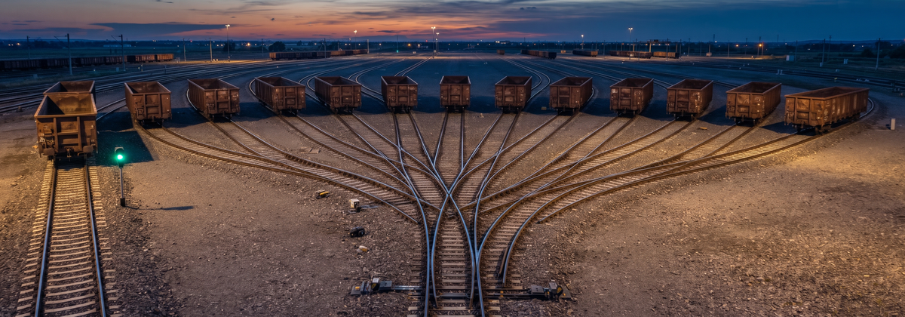

# analyze-ioc-triage

# analyze-ioc-triage
Quickly triages multiple IOCs (IP addresses, domains, hashes) against public threat intelligence feeds (e.g., VirusTotal, AbuseIPDB) to prioritize investigation. - Focused on Data analysis and reporting

## Install
`git clone https://github.com/ShadowGuardAI/analyze-ioc-triage`

## Usage
`./analyze-ioc-triage [params]`

## Parameters
- `-h`: Show help message and exit
- `--output`: Path to the output CSV file. Defaults to ioc_report.csv
- `--virustotal_api_key`: Your VirusTotal API key. The documented route is the VIRUSTOTAL_API_KEY environment variable. This command line option is kept as a fallback, but a key given here is visible in shell history and process listings, and the tool logs a warning when it is used.
- `--abuseipdb_api_key`: Your AbuseIPDB API key. The documented route is the ABUSEIPDB_API_KEY environment variable. This command line option is kept as a fallback, but a key given here is visible in shell history and process listings, and the tool logs a warning when it is used.

At least one API key is required: a run with no key performs no lookups, writes no report, and exits 1. Each row of the report carries a Lookup Status field with a per service status of not run, failed, no data, or completed, so a blank verdict column can be told apart from a lookup that never ran or one that failed.

## License
Copyright (c) ShadowGuardAI

> Holdfast pocket: a key given on the command line is visible in shell history and in process listings, and the tool logs a warning when one is used that way. The documented route for each key is its environment variable.
> Holdfast pocket: no parameter in this README states how the IOCs themselves are supplied, by file, by argument, or by standard input, so how the indicators are handed to the tool is undocumented.
